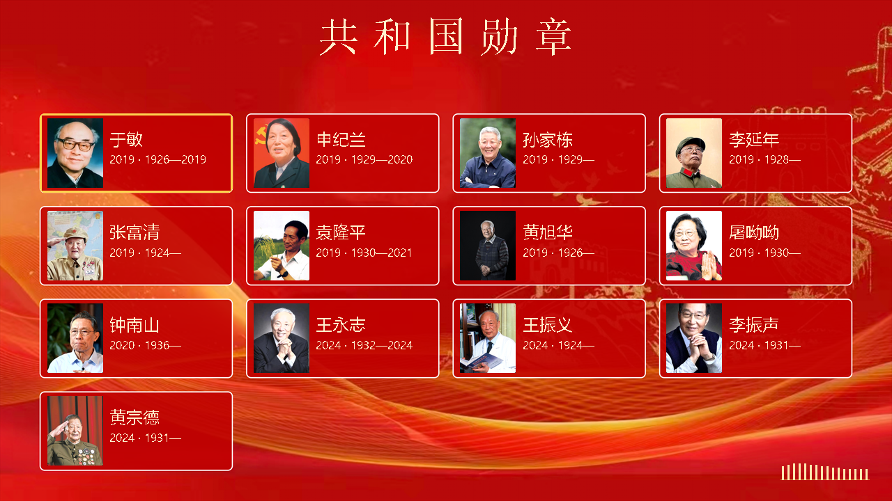

# 基于安路 FPGA 的交互式功勋人物数字展屏

面向公共展陈的独立数字展屏，以共和国勋章获得者为主题，集成人物导航、双语图文、中文讲解、互动问答、开场视频和实时音频频谱。最终程序已固化至开发板配置 Flash；插好 TF 卡并上电后，自动播放开场，随后进入人物首页，运行时无需电脑。



## 硬件与功能

| 项目 | 最终配置 |
| --- | --- |
| 开发板与器件 | HX4S20C V1.0，Anlogic EG4S20BG256 |
| 显示输出 | HDMI B，1280×720；75 MHz 像素时钟，约 60.606 Hz 显示刷新率 |
| 开场视频 | 640×360、15 fps、75 帧 / 5 秒，双线性放大至 720p；含原声、频谱和淡出淡入首页 |
| 内容 | 13 位人物；生平、主要贡献、代表事迹、互动问答四类栏目 |
| 讲解与字幕 | 143 条中文讲解；中文标题先显、正文随讲解渐显；英文整条显示，语音保持中文 |
| 实时频谱 | 256 点实输入 DFT、8 个分析频带、16 根细柱显示；分析实际混合音频 |
| 图像与交互 | TF 图层、等比例图片适配、人物照片平移放大 / 缩回、高亮导航、自动轮播 |
| 显示与声音设置 | 亮度、音量均为 0～100，步长 10；圆角连续柱和数字实时叠加 |
| 存储 | U39 W25Q16 配置 Flash；8 MiB 封装内硬 SDRAM；FAT32 TF 素材卡 |

TF 卡中保存图片、字幕遮罩、PCM 音频及开场数据。电脑预先把 MP4 转为本项目的 Q3V 块编码格式，FPGA 实现对应读取、块解码与放大；当前板端不直接解码 H.264 MP4。开场源帧率与 HDMI 显示刷新率是两个不同参数。

PCM 采用 16 kHz、16 位有符号小端单声道格式，输出为 48 kHz HDMI 音频。背景音乐循环播放，讲解时降低伴奏音量并混合；开场频谱分析其原声音轨。

## 按键与开关

| 控件 | 操作 |
| --- | --- |
| KEY1 / KEY2 | 循环选择下一项 / 上一项；内容页推进 / 退回一条 |
| KEY3 | 返回上一级；在首页重播开场 |
| KEY4 | 进入所选人物或栏目；问答中确认答案 |
| 人物页长按 KEY1 | 同一人物图层平移并等比例放大至全高；再次长按缩回 |
| SW2 | 中英文屏幕文字切换，讲解保持中文 |
| SW3 | 自动轮播人物、生平、贡献和事迹，跳过问答；关闭后回首页 |
| SW4 | 打开亮度 / 音量设置；KEY3 / KEY4 循环选择，KEY1 / KEY2 增减 10 |

设置关闭后保留本次会话数值，重新上电恢复默认 100。音量 0 为静音；亮度 0 时设置控件仍可见，便于恢复。SW1 未作为最终功能入口。

## 快速复现

需要 Windows、Python 3.10 或以上，以及 Tang Dynasty 6.2.168116 工程版和 EG4 器件库。建议克隆至较短的本地路径。完整素材已包含在本仓库，无需另行下载。

```powershell
# 校验原提交包的文件、89 项工程输入及 371 个 TF 文件
python verify_package.py

# 仅展开检查，不执行综合、布局布线或位流生成
python build.py --check-only --td "C:/Anlogic/TD_6.2.1_Engineer_6.2.168.116"

# 完整构建
python build.py --td "C:/Anlogic/TD_6.2.1_Engineer_6.2.168.116/bin/td_commands_prompt.exe"
```

也可设置 `TD_HOME` 或将 `td_commands_prompt.exe` 加入 `PATH`。展开检查输出到 `fpga/check_run/`，完整构建输出到 `fpga/build_run/`，均不会覆盖已验收位流。工程顶层为 `top`，入口文件沿用开发命名 `top_title_waveform_candidate.v`；以工程清单和构建脚本为准。

实物复现可直接使用 `fpga/prebuilt/medal_final.bit`。将 `tf_card/` 中的 **371 个文件**放入 FAT32 TF 卡根目录，安全弹出后插回断电的开发板；接好 HDMI B 和音频输出，初次启动先关闭 SW3、SW4。首次配置或更新 Flash 的手动操作见 [完整提交与复现说明](README_提交与复现说明.txt) 及 `deploy/`。构建和包校验脚本不会烧写板卡或访问 TF 卡。

最终验收位流的 SHA-256：

```text
e97e2a9e39c9b46f131ff39e659e2ffbd45151c6606b8c1ebaab938e1bb2e945
```

## 目录

```text
build.py                    独立输出目录的可移植构建入口
verify_package.py           原提交文件与 TF 素材完整性校验
fpga/source/                RTL、约束、生成 IP、字库及语音时序 HEX
fpga/rtl/                   开场预载、块解码、缓存与会话控制
fpga/run/                   相对路径 TD 工程及 ROM 初始化文件
fpga/prebuilt/              最终验收位流
fpga/reference_reports/     最终冻结构建的资源与时序报告
fpga/tests/                 控件、像素和音频流水模块的测试及原始结果
tf_card/                   可直接复制到 TF 根目录的全部素材
offline_reference/         素材、字幕、语音及视频离线制作代码与参考数据
deploy/                    需手动执行的下载、固化及校验 Tcl
docs/                      第三方说明、展开检查记录与首页预览
release.json                冻结版本和路径整理记录
MANIFEST.sha256             原提交包文件清单
tf_manifest.json            TF 文件长度与 SHA-256
```

`offline_reference/` 保留部分历史开发路径，便于审阅素材制作过程；硬件重建使用包根 `build.py`。本仓库新增的 README、首页图及 Git 配置不改变原提交清单，`verify_package.py` 仍按原清单核验。

## 验收与工程边界

最终版本为 `final_flash_settings_percent_20261103`，已完成配置 Flash 写入、写后校验与断电自启动验收。功能回归包括开场及重播、声音和转场、人物导航、语音字幕、双语、轮播、问答、照片聚焦及百分比控件。

最终冻结资源报告记录 LUT 17877 / 19600、寄存器 9406 / 19600、BRAM9K 46 / 64、BRAM32K 14 / 16、DSP 9 / 29、PLL 2 / 4。当前静态时序报告仍有负裕量：全局建立时间 −6.692 ns、保持时间 −1.540 ns，视频时钟域建立时间 −5.385 ns。**实机功能验收与静态时序签核分别记录，当前工程不宣称时序全闭合。**

定向模块回归记录包含 3,807,973 项流水断言、950,432 个像素比较及 6,239 个有效音频采样比较，范围见 `fpga/tests/`。TD 展开检查记录见 `docs/validation/`；这些记录与完整系统实机验证有各自的范围。

## 第三方与素材归属

板卡基础接口代码、厂商 HDMI / SDRAM 加密模块及生成 IP 保留原有标识与归属。人物图文、音乐、字体及原视频素材仍按各自来源和授权处理；本仓库不为第三方内容另行授予统一的 MIT 或其他开放许可。详见 [第三方组件和来源说明](docs/THIRD_PARTY.txt)。
